# 👩‍🏫 샘옥션클래스 🎓 — 서비스 로직 플로우

> 서비스명: **샘옥션클래스**  
> 저장소: **SamAuction**  
> 기준 코드: `src/domain/auction-engine.mjs`, `assets/store.js`  
> 다이어그램: GitHub에서 Mermaid로 자동 렌더링됩니다.

이 문서는 **선생님(공급자)**, **학생**, **학부모·보호자**, **운영자** 관점에서
월간 1:1·그룹 과외 경매가 어떻게 이어지는지 정리한 서비스 로직 플로우입니다.

---

## 1. 액터와 책임

| 액터 | 코드 역할 | 로그인 | 핵심 책임 | 주요 화면 |
| --- | --- | --- | --- | --- |
| **선생님** | `TEACHER` | O | 수업 경매 등록, 입찰 현황 확인, 프리미엄 끌올, 정산 확인 | `/teacher`, `/teacher/new` |
| **학생** | 자녀 프로필 | X | 보호자와 함께 경매를 선택하고 수업에 참여 | `/student` (보호자 화면) |
| **학부모·보호자** | `GUARDIAN` | O | 자녀 등록, 입찰, 결제, 일정 확정, 수업 완료 | `/student`, `/auction/:id` |
| **운영자** | `ADMIN` | O | 경매·결제·정산 모니터링, 강제 마감, 정산, 환불 | `/admin` |

> 학생은 독립 로그인 계정이 아니라 **보호자 계정에 등록된 자녀 프로필**로 참여합니다.
> 일반 보호자는 자녀 1명, 프리미엄 보호자는 최대 5명까지 등록할 수 있습니다.

### 수업 방식

`assets/views-dash.js` 등록 폼에서 선택하고, `src/domain/auction-engine.mjs`의
`validateLessonMode()`가 저장 전에 검증합니다.

| 방식 | 코드 | 검증 규칙 | 학생·학부모 화면 |
| --- | --- | --- | --- |
| 1:1 방문교육 | `VISIT` | 가능 지역 1개 이상 필수 | 목록·상세·입찰 모달에 `1:1 방문교육` 표시, 입찰 지역은 선생님 가능 지역으로 제한 |
| 1:1 화상교육 | `ONLINE` | 지역 없이 등록 가능 | `1:1 화상교육`, 지역은 `화상 · 지역 무관` |
| 1:1 방문·화상 | `BOTH` | 가능 지역 선택 | `1:1 방문·화상` |
| 1:n 그룹 교육 | `GROUP` | 그룹 정원 2~8명 필수 | `1:n 그룹 교육 (정원 N명)`, 상세 플랜에 그룹 정원 표시 |

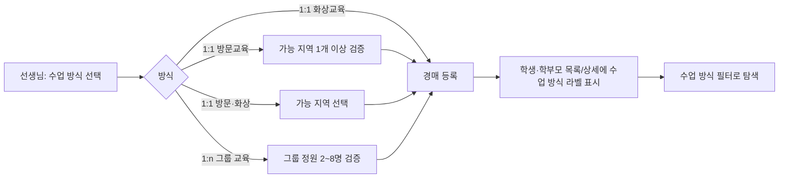

> 프로토타입의 그룹 경매는 **정원 N명 중 1자리**를 낙찰합니다. 다자리 동시 낙찰은
> 실제 서비스 확장 항목입니다.

---

## 2. 전체 서비스 흐름

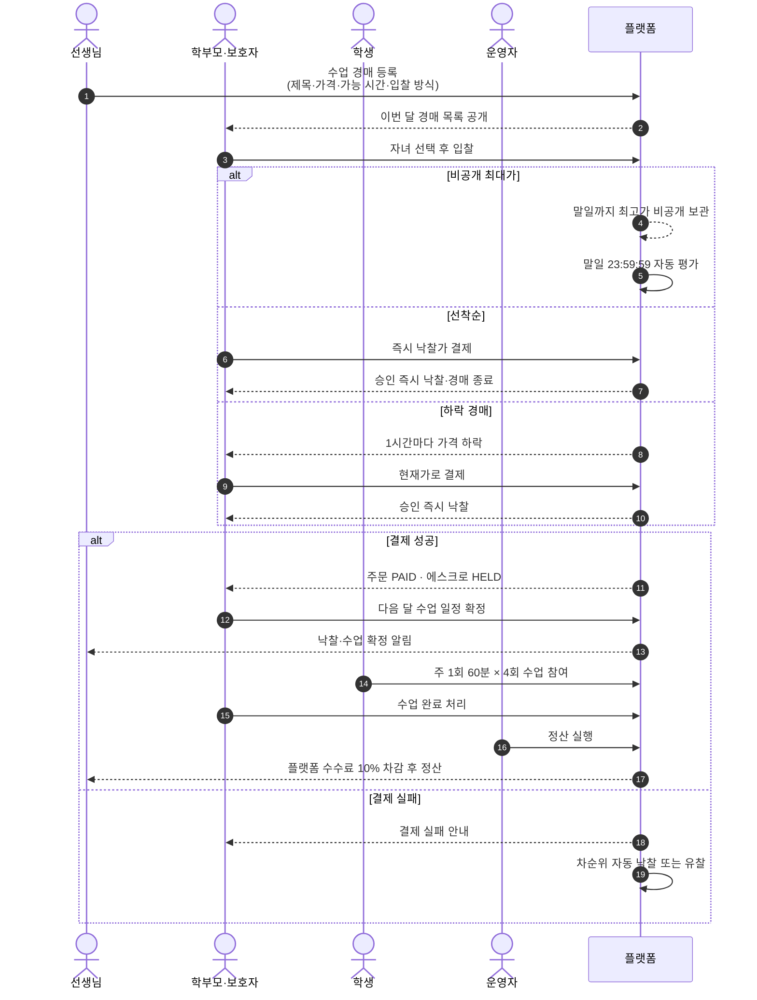

### 월간 사이클

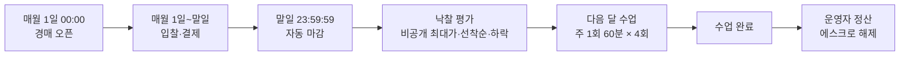

---

## 3. 선생님 플로우

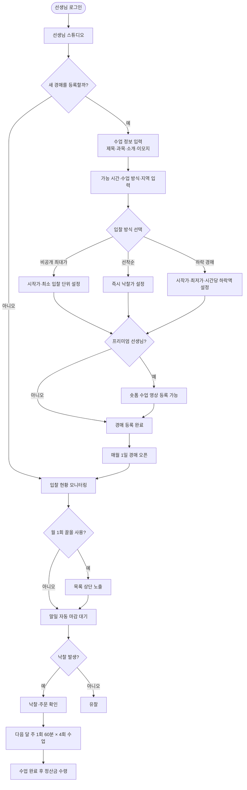

### 선생님 규칙

- 경매 등록은 `TEACHER` 계정만 가능합니다.
- 선생님은 본인 경매에 입찰할 수 없습니다.
- 프리미엄 선생님만 숏폼 영상 등록과 **월 1회 끌올**을 사용할 수 있습니다.
- 정산은 수업 완료 후 운영자가 실행하며, 결제액의 **10%**가 플랫폼 수수료로 차감됩니다.

---

## 4. 학생 플로우

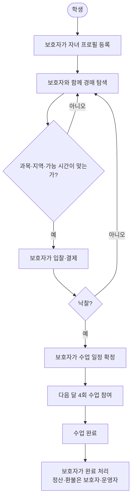

### 학생 규칙

- 학생은 입찰·결제 권한이 없습니다. 모든 계약 행위는 **보호자**가 수행합니다.
- 입찰 시 보호자 동의가 필수입니다.
- 수업은 낙찰 다음 달에 **주 1회 60분 × 4회**로 진행됩니다.

---

## 5. 학부모·보호자 플로우

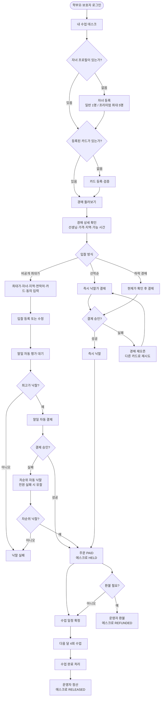

### 학부모·보호자 규칙

- 입찰은 `GUARDIAN` 계정만 가능하며, 자녀 프로필과 보호자 동의가 필요합니다.
- 방문 수업은 선생님이 설정한 **가능 지역** 안에서만 입찰할 수 있습니다.
- 비공개 최대가는 말일까지 다른 사람에게 공개되지 않습니다.
- 선착순·하락 경매는 **결제 승인 즉시** 낙찰됩니다.
- 환불은 운영자가 `PAID`·`CONFIRMED`·`COMPLETED`·`DISPUTED` 상태에서 처리할 수 있습니다.

---

## 6. 운영자 플로우

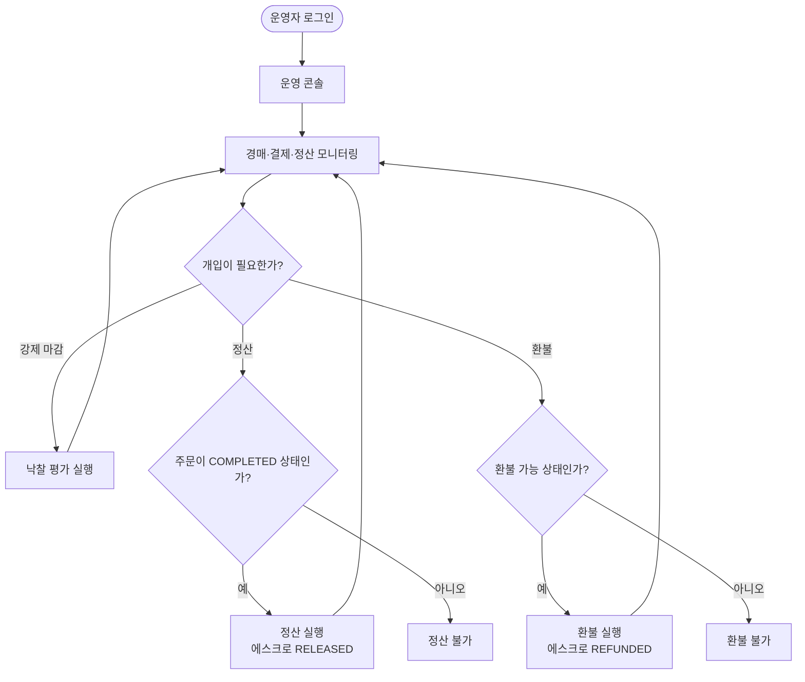

### 운영자 규칙

- 월말 자동 마감은 서버 스케줄러가 담당합니다. 프로토타입에서는 데모 도구로 재현합니다.
- 강제 마감 시 비공개 최대가 평가와 결제 시도가 즉시 실행됩니다.
- 정산은 **수업 완료(`COMPLETED`)** 주문만 가능합니다.
- 환불 시 결제 상태가 `REFUNDED`로 바뀌고 에스크로가 해제됩니다.

---

## 7. 입찰 방식별 상세 플로우

### 7.1 비공개 최대가 (`SEALED_MAX`)

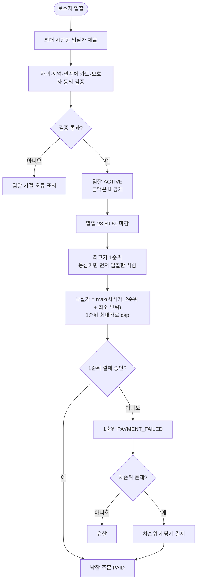

- 최소 입찰 단위는 기본 **1,000원**입니다.
- 2순위가 없으면 시작가로 낙찰됩니다.
- 낙찰자의 결제가 실패하면 차순위 후보로 자동 재낙찰합니다.

### 7.2 선착순 (`FIRST_COME`)

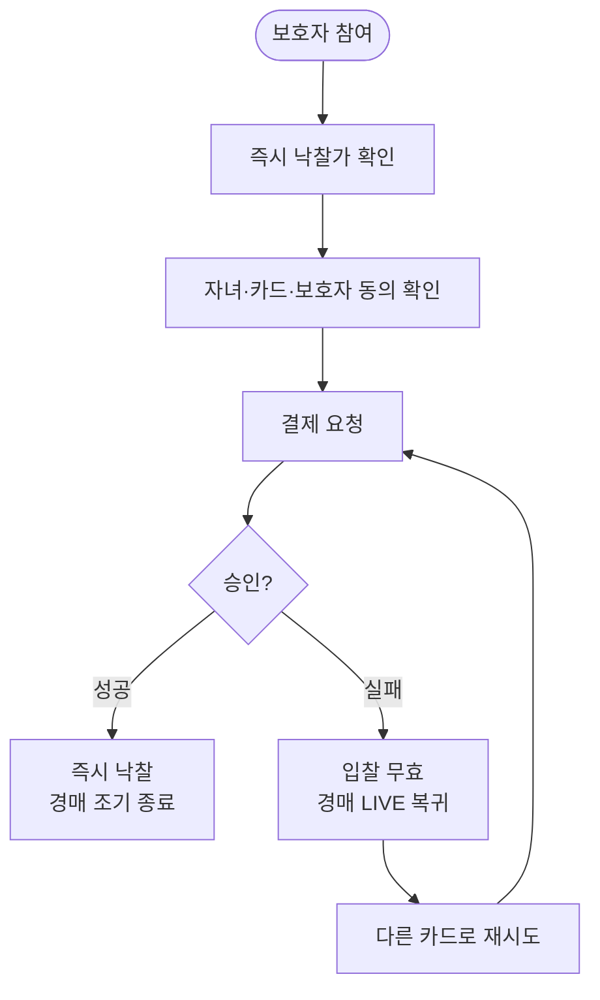

- 결제가 승인된 **첫 번째** 보호자가 낙찰됩니다.
- 결제 실패 시 입찰은 확정되지 않고 경매가 다시 열립니다.

### 7.3 하락 경매 (`DUTCH`)

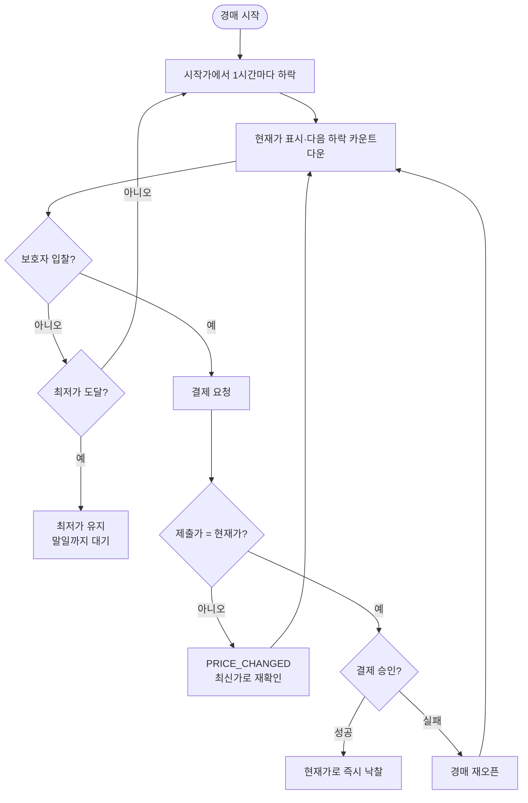

- 가격은 등록 시점부터 **1시간 단위**로 내려갑니다.
- 최저가에 도달하면 말일까지 최저가를 유지합니다.
- 결제 직전에 가격이 바뀌면 `PRICE_CHANGED`로 거절하고 최신가를 다시 확인합니다.

---

## 8. 상태 다이어그램

### 8.1 경매 상태

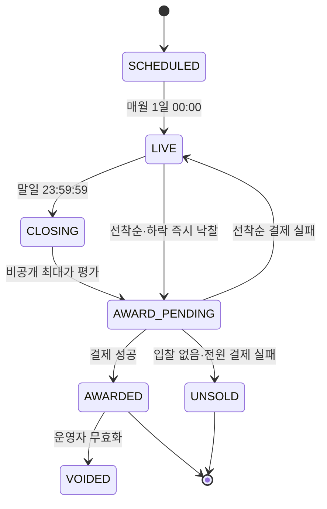

### 8.2 주문 상태

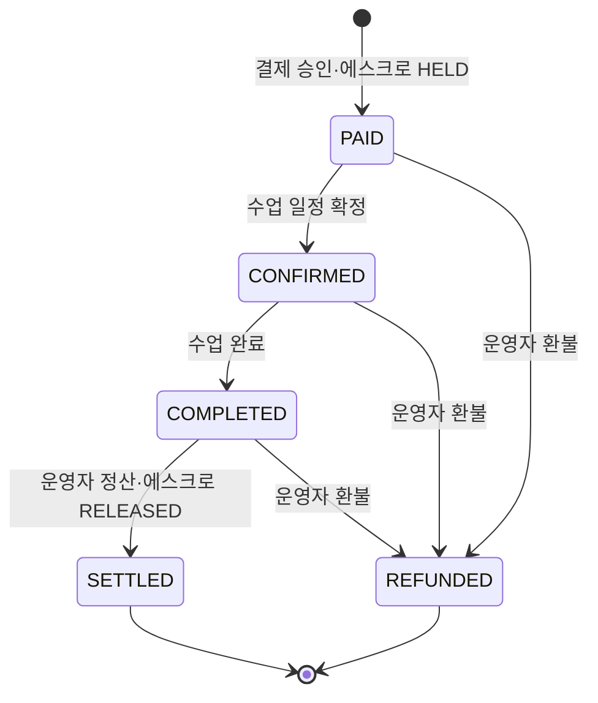

### 8.3 입찰 상태

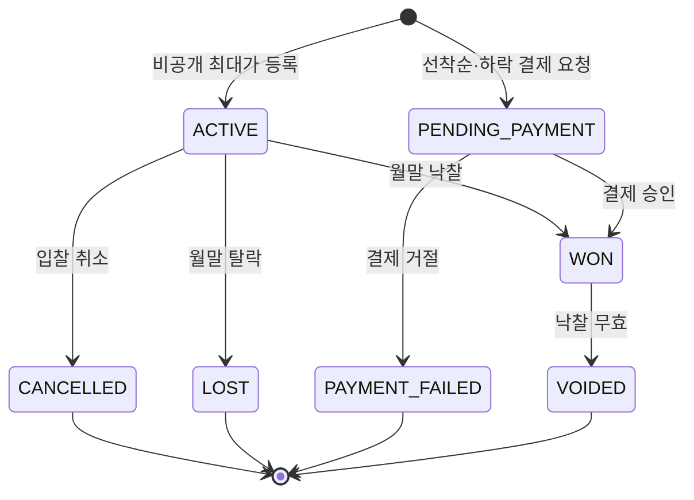

---

## 9. 권한 매트릭스

| 기능 | 선생님 | 학생 | 학부모·보호자 | 운영자 |
| --- | :---: | :---: | :---: | :---: |
| 경매 등록 | O | X | X | X |
| 입찰 | X | X | O | X |
| 결제 | X | X | O | X |
| 자녀 프로필 등록 | X | X | O | X |
| 카드 등록 | X | X | O | X |
| 수업 일정 확정 | X | X | O | X |
| 수업 완료 처리 | X | X | O | X |
| 강제 마감 | X | X | X | O |
| 정산 | X | X | X | O |
| 환불 | X | X | X | O |
| 프리미엄 끌올 | O (본인 경매) | X | X | X |

---

## 10. 예외 처리 규칙

| 상황 | 처리 |
| --- | --- |
| 비공개 최대가 동점 | 먼저 입찰한 사람이 낙찰 |
| 낙찰자 결제 실패 | 차순위 자동 재낙찰, 전원 실패 시 `UNSOLD` |
| 선착순 결제 실패 | 입찰 무효, 경매 `LIVE` 복귀 |
| 하락 경매 가격 변경 | `PRICE_CHANGED` 후 최신가로 재확인 |
| 입찰 취소 | `LIVE` 상태에서만 가능 |
| 일정 확정 | `PAID` 상태에서만 가능 |
| 수업 완료 | `CONFIRMED` 상태에서만 가능 |
| 정산 | `COMPLETED` 상태에서만 가능 |
| 환불 | `PAID`·`CONFIRMED`·`COMPLETED`·`DISPUTED` 상태에서 가능 |
| 자녀 수 초과 | 일반 1명, 프리미엄 5명 제한 |
| 프리미엄 기능 | 숏폼 영상·끌올은 프리미엄만 가능 |
| 끌올 제한 | 선생님당 월 1회 |
| 보호자 동의 누락 | 입찰 거절 |

---

## 11. 코드 매핑

| 로직 | 위치 |
| --- | --- |
| 월간 사이클·하락 가격·비공개 평가 | `src/domain/auction-engine.mjs` |
| 입찰 검증·상태 전이 | `src/domain/auction-engine.mjs` |
| 경매 등록·끌올·입찰·결제·정산 | `assets/store.js` |
| 모의 PG·카드 검증 | `assets/payment.js` |
| 선생님·학생·운영자 화면 | `assets/views-dash.js` |
| 홈·경매 상세·입찰 패널 | `assets/views-home.js` |
| 입찰·카드·일정·영수증 모달 | `assets/modals.js` |
